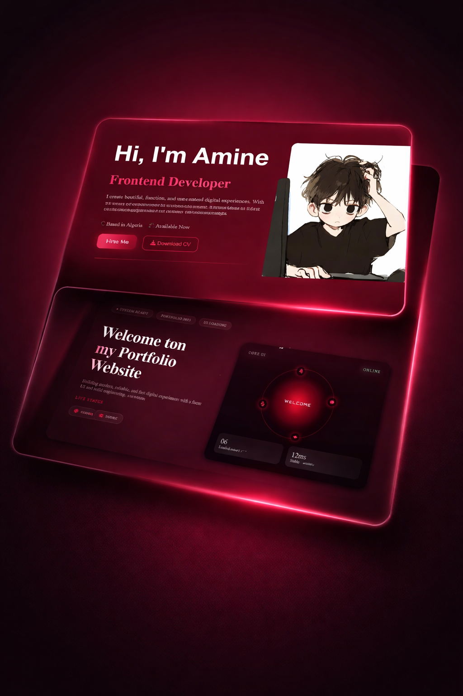

# Atharv Portfolio Showcase 💻

Welcome to Atharv's Portfolio Showcase!
A modern and elegant personal portfolio website built to present my projects, skills, and professional journey using HTML,CSS,JS.
---

## Live Demo 🚀

You can view the live website here: [Live Demo](https://cyber-atharv.github.io/portfolio-8/)

---

## 🌟 Website Sections

- **Home**: Developer introduction with avatar and short description  
- **About**: Experience, tech stack, personal insights, and skill cards  
- **Projects**: Showcase of projects with images, descriptions, and skills  
- **Services**: Highlighting services offered with interactive cards  
- **Contact**: Contact form and social links with interactive hover effects  

---

## ⚡ Features

- Clean & modern UI design
- Smooth animations and transitions
- Fully responsive (Desktop / Tablet / Mobile)
- Interactive sections & hover effects
- Clean and organized code structure
- Fast performance & lightweight 

---

## 🛠 Technologies Used

- **HTML** – Structure and semantic content
- **CSS3** – Styling, responsive layouts, Flexbox & Grid 
- **JavaScript (Vanilla JS)** – Interactivity and animations
- **Font Awesome / Boxicons** – Icons -
- **AOS.js** – Scroll animations

---

## License

This project is licensed under the terms described in the [LICENSE](LICENSE) file.

---

## 🚀 How to Use / Customize

1. **Clone the repository:**

 ---

## ?? Contact

- Email: [atharvhogade12@gmail.com](mailto:atharvhogade12@gmail.com)
---

Made with ❤️ by **Atharv**


```bash
git clone https://github.com/cyber-atharv/portfolio-8.git
